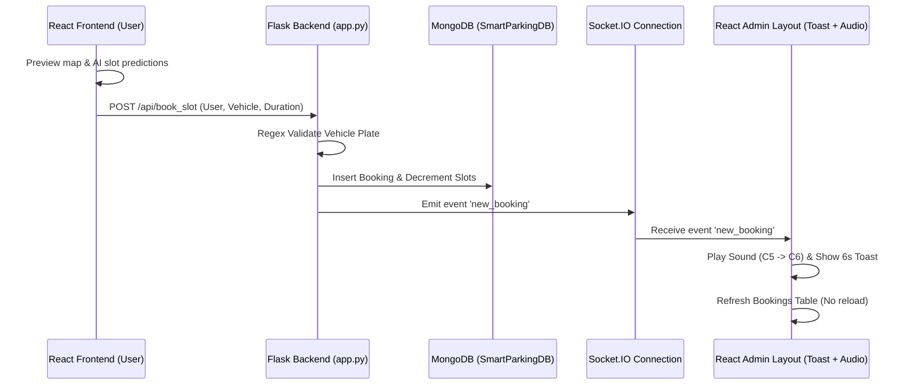

# 🎓 AI-Enhanced Smart Parking System - Viva Defense Guide

This comprehensive guide is designed for your capstone/mid-viva defense. It explains the project's architecture, database design, machine learning pipeline, and real-time synchronization flows in simple, clear technical terms.

---

## 📌 1. Project Overview

The **AI-Enhanced Smart Parking System** is a next-generation smart city application designed to optimize parking space management in high-congestion commercial hubs of Islamabad (e.g., Centaurus Mall, Safa Gold Mall, F-6, F-7, and F-10 Markazes). By combining **real-time WebSockets (Socket.IO)**, **interactive 3D structural layouts**, and a **hyperparameter-tuned XGBoost predictive model**, the system enables drivers to preview live slot availability, assess prediction accuracy under various traffic/weather conditions, and secure bookings instantly.

---

## ⚙️ 2. System Architecture (The Booking Lifecycle Flow)

The system works as a Single Page Application (SPA) with real-time bi-directional messaging. Here is the step-by-step lifecycle of a booking:

1. **AI Occupancy Check**: The user browses the React interface, where the frontend makes a `POST` request to `/predict` on the Flask API to forecast whether a specific slot will be available based on current time, traffic, and weather.
2. **Booking Submission**: The user submits a booking. React validates the input (e.g., checking Pakistan license plate regex formats) and calls the `POST /api/book_slot` endpoint.
3. **Database Transaction**: The Flask backend receives the payload, reserves the slot layout by marking the slot as `isBooked: true`, decrements the overall `available` count for that location, and writes the booking details to the `bookings` collection.
4. **WebSocket Broadcast**: Immediately upon database success, Flask calls `socketio.emit('new_booking', data)` to broadcast the event to all connected administrators.
5. **Admin Alerting**: The persistent React admin layout catches the event, programmatically plays a browser-native audio chime (a C5 to C6 frequency sweep), and pops up a glassmorphic Toast alert.
6. **Auto-Refresh Grid**: The bookings dashboard listens for the WebSocket event and immediately triggers `fetchBookings()` to update the data grid in the background without forcing a page reload.
7. **Session Completion**: When the user checkouts or completes their parking session, a request to `/api/bookings/<id>/finish` updates MongoDB, releases the slot, and broadcasts `booking_finished` to play a checkout chime (A5 to A4) and auto-update the table.

---

## 🗄️ 3. Database Integration & Collections

We use **MongoDB** (connected locally on `mongodb://localhost:27017` via **PyMongo**), storing documents inside the **`SmartParkingDB`** database across five primary collections:

* **`slots`**: Stores metadata for the 9 key Islamabad parking lots. This includes capacity, coordinates (latitude/longitude), hourly rate (PKR), total earnings, occupancy rates, and a full structural array (`slot_layouts`) mapping individual slot numbers (e.g., `S-1` to `S-1000`) and EV chargers.
* **`bookings`**: Records all reservations with fields such as `booking_id`, `parking_name`, `user_name`, `vehicle_number` (license plate), `booking_time`, `duration_hours`, `total_cost`, `slot_number`, and lifecycle status (`confirmed`, `active`, `completed`, `cancelled`).
* **`users`**: Manages customer registration and secure logins, storing passwords safely hashed using **Werkzeug's PBKDF2** cryptography.
* **`contacts`**: Holds user support inquiries and feedback forms submitted via the landing page contact section.
* **`settings`**: Holds global configurations, such as default hourly base rates, parking cancellation grace hours, and active administrative hours.

---

## 🧠 4. Machine Learning Deep Dive

The machine learning engine is built using **scikit-learn**, **imbalanced-learn**, and **XGBoost**.

### The Feature Engineering Pipeline (`preprocess.py` & `enhance_features.py`)
We map raw parking timelines into 11 highly-predictive features reflecting actual human routines:
1. **`hour`**: Hour of the day (0-23) to represent time-of-day demand.
2. **`day_of_week`**: Day index (0-6) to track weekday vs. weekend behaviors.
3. **`is_weekend`**: Binary indicator (1 for Sat/Sun, 0 otherwise).
4. **`is_rush_hour`**: Highlighted commute peaks (7:00–10:00 AM and 4:00–7:00 PM).
5. **`is_night`**: Off-peak hours matching Pakistan's sunset patterns (7:00 PM to 5:00 AM).
6. **`is_working_hour`**: Standard office hours (9:00 AM to 5:00 PM on weekdays).
7. **`Nearby_Traffic_Level`**: Categorical (Low, Medium, High) mapped dynamically to peak hours.
8. **`Weather_Temperature`**: Structured seasonal Pakistan climate logic:
   * **Summer** (May, Jun, Jul, Aug): ~38°C
   * **Winter** (Nov, Dec, Jan, Feb): ~12°C
   * **Spring/Autumn** (Mar, Apr, Sep, Oct): ~25°C
9. **`Weather_Precipitation`**: Tracks rain levels (0.0 to 1.0) since bad weather shifts demand.
10. **`Proximity_To_Exit`**: Determines spot desirability (lower numbers indicate closer slots).
11. **`Spot_Size`**: Compact, Standard, or Oversized dimensions mapped deterministically.

### Handling Imbalanced Data (SMOTE)
In our dataset, "Occupied" states (0) outnumber "Available" states (1) during commercial peaks. To prevent the model from ignoring the minority class, we apply **SMOTE** (Synthetic Minority Over-sampling Technique) strictly to the training split. This synthesizes new minority class instances along the line segments of existing neighbors, ensuring balanced learning boundaries without leaking test data.

### Model Comparison & Selection (`model_selection.py`)
Our training pipeline trains and compares **four distinct classifiers**:
1. **Logistic Regression**: Linear baseline model.
2. **Random Forest**: Ensemble decision-tree model.
3. **XGBoost**: Extreme Gradient Boosting tuned with 3-fold cross-validated grid search (`GridSearchCV`) targeting hyperparameters like `max_depth` (3, 5, 7) and `learning_rate` (0.05, 0.1, 0.15).
4. **Keras Neural Network**: Deep learning sequential model.

* **The Winner**: **XGBoost** (loaded via `ml/parking_model.pkl`). It achieves an exceptional balance of **87.76% accuracy** and an **80.58% F1-score**, proving robust against non-linear interactions in weather, proximity, and rush hour features.

---

## 💬 5. Top 5 Likely Viva Questions & Answers

### 🙋‍♂️ Q1: Why did you use WebSockets (Socket.IO) instead of simple HTTP polling for the admin panel?
**Answer:** 
HTTP polling forces the client to make request calls to the server at fixed intervals (e.g., every 5 seconds) to check for new bookings. This creates high network overhead, wastes bandwidth with empty responses, and introduces a delay. **Socket.IO provides persistent, full-duplex TCP connections**, allowing our Flask backend to push real-time events (`new_booking`, `booking_finished`) to the React client *instantly* the moment a database transaction occurs.

---

### 🙋‍♂️ Q2: Explain what SMOTE is and why you only applied it to the training partition.
**Answer:** 
SMOTE stands for **Synthetic Minority Over-sampling Technique**. It resolves class imbalance (where we have many more occupied records than vacant records) by generating synthetic minority examples rather than duplicating existing ones. We apply SMOTE **only to the training partition** because applying it to the entire dataset before splitting causes **data leakage**, meaning the model would be evaluated on synthetic samples derived from test-set information, falsely inflating performance metrics.

---

### 🙋‍♂️ Q3: How is the Machine Learning model integrated into the Flask server?
**Answer:** 
During the preprocessing and training phases, we export three artifacts: `parking_model.pkl` (the trained XGBoost classifier), `scaler.pkl` (StandardScaler fitted on training features), and `encoders.pkl` (LabelEncoder objects for categorical variables like Traffic Level). In `app.py`, we load these pickles at startup. When a prediction request is received, the server encodes and scales the input features using these loaded pickle structures and calls `model.predict_proba()` to estimate vacancy probability.

---

### 🙋‍♂️ Q4: How does the system handle pricing surges dynamically?
**Answer:** 
The system implements a dynamic pricing algorithm. The default price per hour is set based on the specific lot's popularity (e.g., Centaurus is PKR 100/hr, G-9 is PKR 40/hr). In the `/api/parking` route, the backend calculates the live occupancy rate (`(capacity - available) / capacity`). If the live occupancy rate exceeds **80%**, the system applies a **20% surge surcharge** to the parking fee, helping manage demand and maximize parking revenues during peak hours.

---

### 🙋‍♂️ Q5: How did you implement sound effects without using external media files, and why?
**Answer:** 
We used the native **Web Audio API** built into modern browsers. Inside `AdminLayout.jsx`, we programmatically instantiate an `AudioContext` and generate an oscillator node (a synthesizer). For new bookings, we sweep a sine wave frequency from `523.25 Hz` (C5) to `1046.50 Hz` (C6). For finished bookings, we sweep a triangle wave from `880 Hz` (A5) to `440 Hz` (A4). This approach ensures **instant playback** with zero network latency and avoids bundling or hosting heavy static `.mp3` files in the frontend repository.
